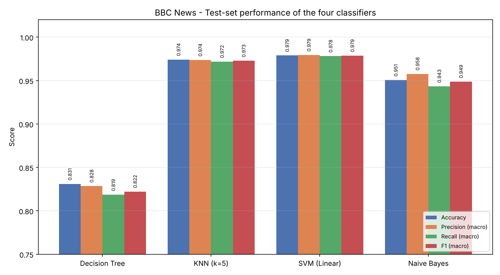
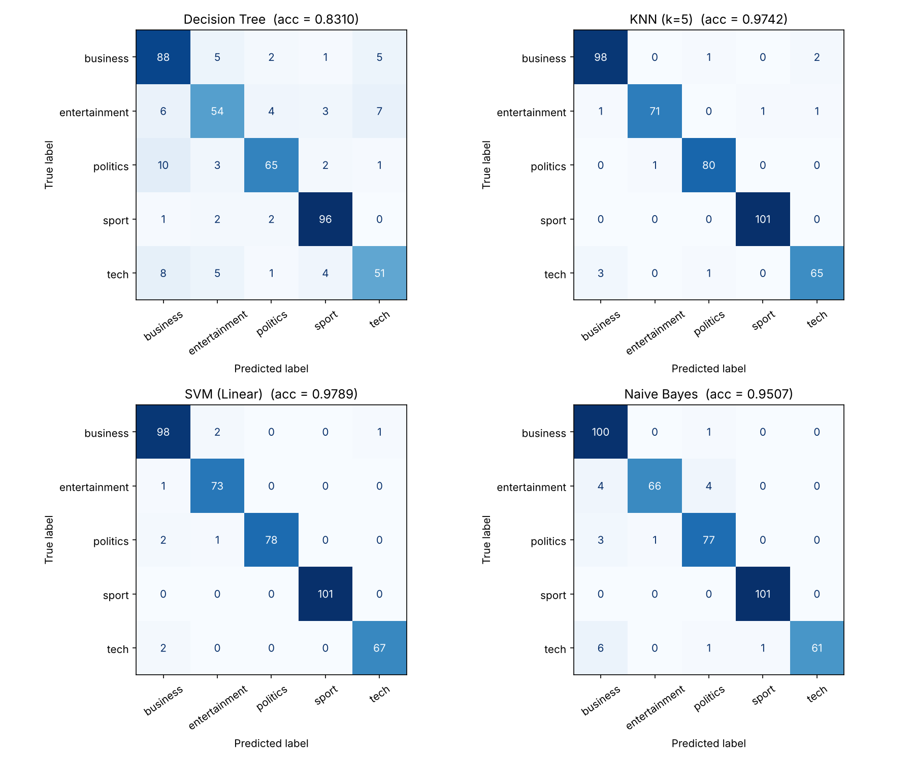
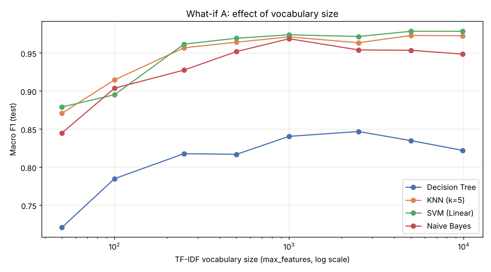
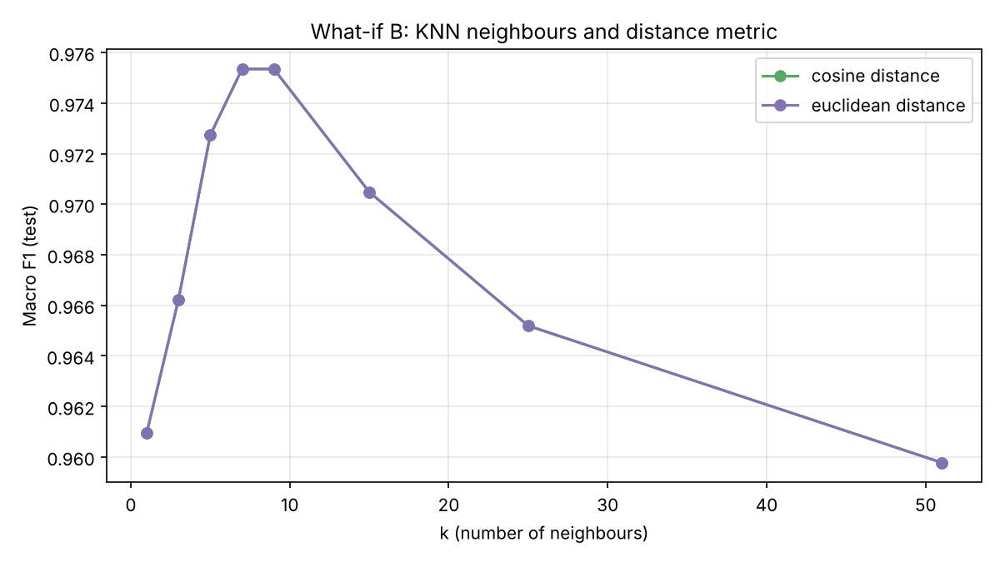

# Text Classification Battle — Decision Tree vs KNN vs SVM vs Naïve Bayes

**Course:** Information Retrieval (21CSE377T) — CLA-2, Task 2
**Student:** K R Vaishak (RA2411026050018), III Year CSE AIML A, SRM IST Tiruchirappalli
**Faculty:** Dr. S. Prabu

This project compares four classifiers on a real news dataset. All four get the same preprocessing, the same TF-IDF features and the same train/test split, so the only thing that changes between them is the algorithm.

## Dataset

**BBC News** (Greene & Cunningham, ICML 2006): 2,225 BBC articles from 2004–2005, each labelled with one of five topics. A CSV copy is included in [`data/bbc-text.csv`](data/bbc-text.csv). It came from a public GitHub mirror of the original University College Dublin release.

The raw file contains 99 exact duplicate articles. These were removed so that no article can appear in both the training and test sets. That leaves **2,126 documents**:

| Class | Documents | % |
|---|---|---|
| sport | 504 | 23.71 |
| business | 503 | 23.66 |
| politics | 403 | 18.96 |
| entertainment | 369 | 17.36 |
| tech | 347 | 16.32 |

The imbalance ratio (largest class ÷ smallest) is 1.45, so the classes are only mildly imbalanced. **Macro**-averaged metrics are reported so that every class counts equally.

## Pipeline

1. **Preprocessing:** lowercase the text, keep alphabetic tokens only, remove stop words (scikit-learn's English list) and tokens of two letters or fewer, then apply Porter stemming. This takes the average document from 390.5 words to 194.6 tokens.
2. **Split:** stratified 80/20 (1,700 train / 426 test) with `random_state=42`.
3. **Features:** `TfidfVectorizer(min_df=2, max_df=0.95, sublinear_tf=True)`. It is fitted on the training set only, which gives a 9,881-term vocabulary with 98.7% sparsity.
4. **Models:** `DecisionTreeClassifier`, `KNeighborsClassifier(k=5, cosine)`, `LinearSVC(C=1)` and `MultinomialNB(alpha=1)`.
5. **Evaluation:** accuracy, macro precision, recall and F1, a confusion matrix for each model, per-class F1, and 5-fold stratified cross-validation on the training set.
6. **What-if experiments:**
   - **(A)** Shrink the TF-IDF vocabulary from all terms down to 50 and re-run all four models.
   - **(B)** Change k and the distance metric in KNN.

## Results (test set, 426 documents)

| Model | Accuracy | Precision | Recall | F1 | 5-fold CV F1 |
|---|---|---|---|---|---|
| Decision Tree | 0.8310 | 0.8285 | 0.8186 | 0.8222 | 0.8045 ± 0.0237 |
| KNN (k=5) | 0.9742 | 0.9737 | 0.9719 | 0.9727 | 0.9544 ± 0.0084 |
| **SVM (Linear)** | **0.9789** | **0.9795** | **0.9782** | **0.9787** | **0.9774 ± 0.0043** |
| Naïve Bayes | 0.9507 | 0.9576 | 0.9433 | 0.9487 | 0.9575 ± 0.0038 |

**Best model: Linear SVM.** It classifies 417 of the 426 test articles correctly and has the highest and most stable cross-validation score.






The full discussion is in [`report/`](report/).

## How to run

```bash
pip install -r requirements.txt
python main.py
```

A run takes about 15 seconds. Every table and figure is regenerated into `results/` and `figures/`, and the console output is saved to `results/run_log.txt`.

## Repository layout

```
main.py                 # complete experiment pipeline
data/bbc-text.csv       # dataset
results/                # CSV/TXT outputs (metrics, confusion matrices, what-if tables, run log)
figures/                # generated plots
report/                 # project report (PDF + DOCX)
requirements.txt
```

## Reference

D. Greene and P. Cunningham, "Practical Solutions to the Problem of Diagonal Dominance in Kernel Document Clustering," *Proc. 23rd ICML*, 2006.
